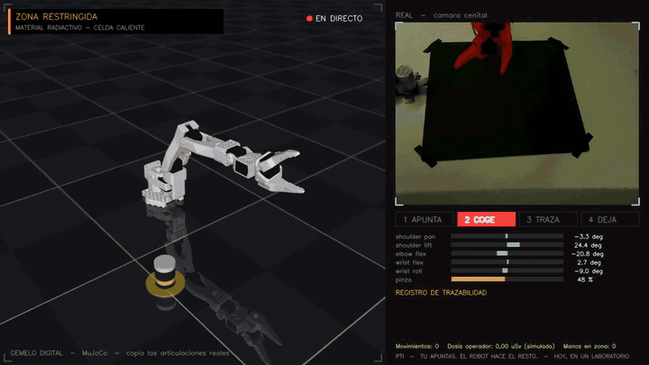
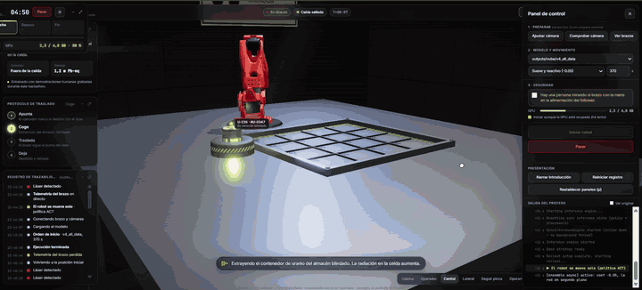
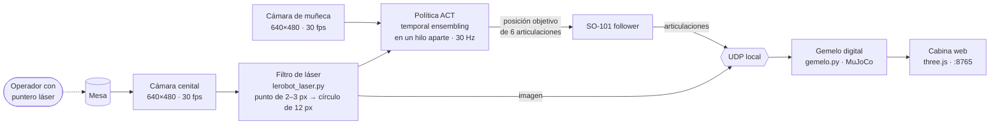
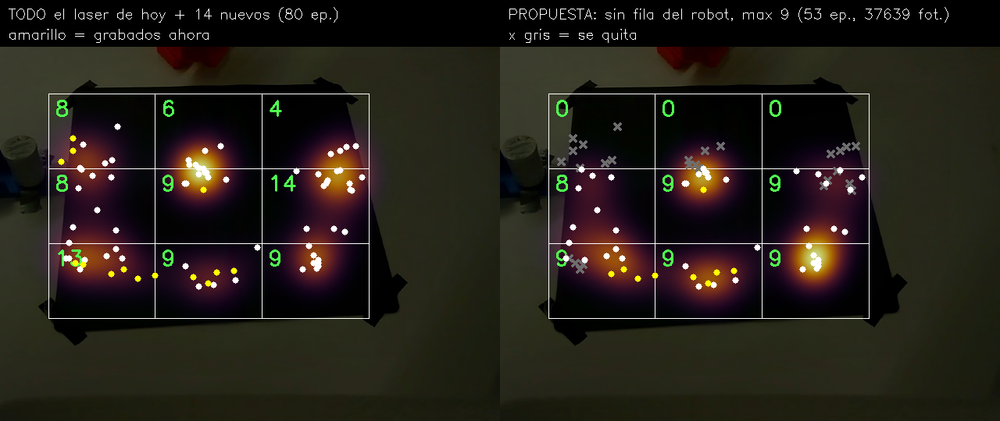

<div align="center">

# PTI · Tú apuntas. El robot hace el resto.

**Un brazo SO-101 que coge un contenedor y lo lleva a donde apuntas con un puntero láser,
movido por una política ACT aprendida por imitación con LeRobot.**

Equipo PTI · [Physical AI Hackathon Bilbao 2026](https://hackathonbilbao.eus/home-page-es) · 20–22 de noviembre de 2026

[](https://github.com/huggingface/lerobot)
[](https://github.com/TheRobotStudio/SO-ARM100)
[](https://huggingface.co/Josebarv01/act_pti_v4_all_data)
[](https://www.python.org/)
[](LICENSE)



<sub>Ejecución real con el modelo <code>v4_all_data</code> (vídeo acelerado ×2). Izquierda: gemelo digital en MuJoCo que copia las articulaciones del robot.
Derecha: cámara cenital con el láser resaltado por el filtro de visión.</sub>

[Español](#la-idea) · [English summary](#english-summary)

</div>

---

## La idea

Hay objetos que ninguna mano humana debería tocar. En las celdas calientes de los laboratorios se
manipula material radiactivo con brazos maestro-esclavo o con guantes a través de un cristal. Hacen
falta operadores con meses de formación y el trabajo es lento y cansado.

Nuestra propuesta es que el operador **apunte desde fuera con un láser** y que el robot,
entrenado por imitación, **coja el contenedor, siga el punto y lo deje donde el láser se apaga**.
Sin mando, sin programar trayectorias y sin un operador experto. El operador dice **qué** quiere y
el robot resuelve el **cómo**.

La misma interfaz sirve donde teleoperar no es viable. Entre la Tierra y la Luna la señal tarda unos
2,6 s en ir y volver, y con ese retraso no se puede guiar un brazo. Un punto marcado es una orden
de alto nivel que aguanta el retraso, y el robot la ejecuta en local.

> **Aviso.** Es una prueba de concepto hecha en 48 horas, no un producto certificado. En la demo el
> «contenedor de muestra» es un cubilete impreso en 3D y está vacío.

<p align="center">
  
  <br><sub>Cabina de operación en el navegador (three.js): el gemelo 3D en la «celda caliente», el protocolo
  Apunta → Coge → Traslada → Deja, el registro de trazabilidad y el panel para lanzar el modelo.</sub>
</p>

## Cómo funciona



1. **Visión del láser.** El punto del láser ocupa 2–3 píxeles en la cámara cenital y la red casi
   no lo ve. [`herramientas/lerobot_laser.py`](herramientas/lerobot_laser.py) envuelve
   `lerobot-record` y `lerobot-rollout`, detecta el punto en cada fotograma (picos pequeños y muy
   rojos, descartando las manchas grandes del brazo naranja) y dibuja encima un círculo rojo
   de 12 px. El mismo filtro se aplica **al grabar y al desplegar**, así que la política aprende a
   mirar el círculo.
2. **Una sola política ACT** con dos cámaras (cenital y muñeca) hace la tarea completa: coger del
   soporte, seguir el láser y soltar cuando se apaga. Los primeros intentos por fases quedan en el
   [diario](docs/DIARIO.md).
3. **Suavizado a 30 Hz.** Con `temporal_ensemble_coeff` cada paso esperaba una inferencia completa
   y el bucle caía a 8–14 Hz en la RTX 2060. `EnsembleEnSegundoPlano` ejecuta la red en un hilo
   aparte y mezcla los bloques alineados en el tiempo, de modo que el brazo se mueve a la misma
   frecuencia a la que se grabó.
4. **Gemelo digital y cabina.** [`herramientas/gemelo.py`](herramientas/gemelo.py) recibe por UDP las
   articulaciones y las imágenes, mueve un SO-101 en MuJoCo y sirve una
   [cabina web](herramientas/web/) con la escena 3D, las fases, la telemetría, un registro de
   trazabilidad y un narrador con voz. Desde la web se lanza el modelo, y no se puede iniciar sin
   confirmar que hay una persona con la mano en la alimentación del brazo.

## Resultados

Todo lo grabamos y lo entrenamos durante el evento. Los números salen del
[diario del equipo](docs/DIARIO.md), donde está cada prueba con su fecha y hora.

| Modelo | Datos | Entrenamiento | En el robot |
| --- | --- | --- | --- |
| `coger_v2` | 15 episodios largos, solo cámara cenital | 5 000 pasos, RTX 2060 (27 min) | 1/5. Tiembla mucho |
| `coger_v7` | 50 episodios, cenital + muñeca | 20 000 pasos, RTX 2060 (3 h 12 min) | Coge ~9/10, pero suelta siempre en el mismo sitio: en las demos el láser estaba apagado |
| `laser_v1` | 45 episodios con láser, fondo negro | 10 000 pasos desde `coger_v7`, A10G | Sigue el láser muy bien, pero no suelta al apagarlo |
| `todo_v1` | 95 episodios (`coger_v7` + láser) | 15 000 pasos desde `coger_v7`, A10G | Suelta al apagar el láser. Fue el modelo de referencia del sábado |
| `todo_v2` / `todo_v3` | 123 episodios (+ refuerzo del centro) | 10 000 / 25 000 pasos desde `todo_v1` | v2 tiembla y va lento. v3 es el que mejor imita sin robot (error 2,6° frente a 3,6°) |
| **`v4_all_data`** | **117 episodios, 91 077 fotogramas** | **57 000 pasos desde cero, A10G** | **El mejor en el robot. Correlación 0,98 en 6 episodios reservados. Es el modelo de la demo** |
| `v4_uniforme_36` | 36 episodios equilibrados por casilla | 15 700 pasos desde cero | Descartado: encoge los giros (error de 11,3° en los reservados) |

<p align="center">
  
  <br><sub>Dónde se soltó el cubilete en las demostraciones, por casilla. Con estos mapas decidimos qué grabar
  para cubrir las zonas vacías.</sub>
</p>

**Cómputo.** Portátil Windows 11 con una RTX 2060 de 6 GB (1,7 pasos/s con dos cámaras) y
Hugging Face Jobs en una `a10g-large` (6,25 pasos/s, unas 3,5 veces más rápido) con 20 $ de
créditos. El script [`entrenar_nube.ps1`](herramientas/entrenar_nube.ps1) instala en la máquina
remota nuestro commit exacto de LeRobot, para que el modelo cargue en el portátil.

## Lo que aprendimos

- **Hacía falta un filtro de visión antes de empezar a grabar.** Sin el círculo, el láser es
  invisible para ACT. El filtro confundió el láser con la base naranja y con el propio brazo, y lo
  corregimos con un detector top-hat y descartando las manchas grandes: 0 falsos positivos en
  935 fotogramas.
- **El modelo aprende lo que se le enseña.** `coger_v7` soltaba siempre en el mismo sitio porque en
  sus 50 demos el láser estaba apagado. `laser_v1` no soltaba porque en las grabaciones el círculo
  desaparece a ratos mientras el brazo lo tapa, así que «sin láser» no siempre significaba «suelta».
- **Mezclar datos funciona mejor que afinar por partes.** Entrenar desde cero con todos los
  datos (`v4_all_data`) ganó a afinar en cadena (`todo_v1` → `v2` → `v3`).
- **Equilibrar los datos a costa de reducirlos salió peor.** El dataset uniforme de 36 episodios se
  desviaba hacia un lado. Para que la comparación fuera justa reservamos 6 episodios que no vio
  ningún modelo.
- **Antes de culpar al modelo, repetir un episodio.** El sábado por la noche se rompió el servo de
  la pinza y nos dieron otro follower. Lo ajustamos sin recalibrar
  ([`ajustar_calibracion.py`](herramientas/ajustar_calibracion.py)): `lerobot-replay` de un episodio
  y comparar con la cámara cenital dónde suelta.
- **Hay que desplegar a la misma frecuencia a la que se graba.** Un rollout a 8–14 Hz de algo
  grabado a 30 Hz se ve a cámara lenta y a tirones.

## Modelos y datos en Hugging Face

| Recurso | Enlace | Acceso |
| --- | --- | --- |
| Modelo de la demo | [`Josebarv01/act_pti_v4_all_data`](https://huggingface.co/Josebarv01/act_pti_v4_all_data) | Público |
| Variante afinada | [`Josebarv01/act_pti_v4_all_data_plus`](https://huggingface.co/Josebarv01/act_pti_v4_all_data_plus) | Público |
| Modelos intermedios | [`act_pti_coger_v7`](https://huggingface.co/Josebarv01/act_pti_coger_v7) · [`act_pti_laser_v1`](https://huggingface.co/Josebarv01/act_pti_laser_v1) · [`act_pti_todo_v1`](https://huggingface.co/Josebarv01/act_pti_todo_v1) · [`act_pti_todo_v3`](https://huggingface.co/Josebarv01/act_pti_todo_v3) · [`act_pti_v4_uniforme_53`](https://huggingface.co/Josebarv01/act_pti_v4_uniforme_53) | Públicos |
| Dataset «coger» (50 ep.) | [`Josebarv01/pti_coger_v7`](https://huggingface.co/datasets/Josebarv01/pti_coger_v7) | Público |
| Dataset «refuerzo del centro» | [`Josebarv01/pti_laser_H_centro`](https://huggingface.co/datasets/Josebarv01/pti_laser_H_centro) | Público |
| Datasets de entrenamiento combinados | `pti_todo_v2`, `pti_todo_v3_uniforme`, `pti_laser_todo` | Privados |

## Estructura del repositorio

```
.
├── PTI_DEMO.bat                 Doble clic: arranca la cabina web de la demo
├── app/                         Visión y mapa virtual de la mesa (OpenCV)
│   ├── config.json              Cámara, medidas de la mesa y parámetros del filtro de láser
│   ├── vision.py                Mesa en centímetros (homografía), láser y cubiletes
│   ├── calibrar.py · mapa.py    Calibración de la mesa y mapa virtual en vivo
│   └── orquestador.py           Fase 1: láser → zona → política por zona (sustituido por la política única)
├── herramientas/
│   ├── lerobot_laser.py         Envoltorio de lerobot-record/rollout: filtro de láser + suavizado a 30 Hz
│   ├── gemelo.py                Gemelo digital MuJoCo + servidor de la cabina web
│   ├── web/                     Cabina de operación (three.js, sin dependencias externas)
│   ├── *.ps1                    Calibrar, teleoperar, grabar, probar y entrenar en la nube
│   ├── calibracion_puesto/      Calibración de los brazos del puesto
│   └── …                        Utilidades: puertos, postura, cámaras, ajuste fino de la calibración
├── piezas/cubilete.stl          Contenedor impreso en 3D (41 mm, nervios para la pinza)
├── tests/test_vision.py         Pruebas de la visión con imágenes sintéticas (sin cámara ni robot)
└── docs/                        Instalación, diario, planes de grabación y pitch (ver docs/README.md)
```

## Puesta en marcha

La guía completa, con cada comando, está en **[docs/INSTALAR.md](docs/INSTALAR.md)**. En resumen:

1. Clonar este repo y el fork de LeRobot que usamos (`Juxi-Technology/lerobot`, commit `3bb7b4a`,
   LeRobot 0.6.2), con el modelo MuJoCo del SO-101.
2. Crear el entorno (Python 3.13, PyTorch con CUDA 12.8, `mujoco`, `rerun-sdk`).
3. Descargar `act_pti_v4_all_data` del Hub.
4. Conectar los brazos (leader a 5 V y follower a 12 V) y las cámaras (cenital y muñeca).
5. Lanzar `PTI_DEMO.bat` y abrir `http://127.0.0.1:8765/`.

> **Seguridad.** Cualquier script que mueva el brazo (rollout, replay, teleoperación) se ejecuta
> con una persona mirando y con la mano en la alimentación del follower. El láser debe ser de
> clase 2 y nunca se apunta a los ojos.

Para comprobar la visión sin hardware:

```bash
pip install opencv-python-headless numpy matplotlib
python tests/test_vision.py
```

## Documentación

| Documento | Contenido |
| --- | --- |
| [INSTALAR.md](docs/INSTALAR.md) | Instalar y lanzar la demo en otro portátil (estado final) |
| [DIARIO.md](docs/DIARIO.md) | Todo lo que probamos, en orden, con sus fallos y diagnósticos |
| [NARRATIVA.md](docs/NARRATIVA.md) | Historia, guion del pitch de 5 minutos y preguntas del jurado |
| [PLAN_LASER.md](docs/PLAN_LASER.md) · [ESCALETA_CENTRO.md](docs/ESCALETA_CENTRO.md) | Planes de grabación por tipos de episodio y casillas |
| [docs/README.md](docs/README.md) | Índice completo |

## English summary

**PTI** (*"You point. The robot does the rest."*) was built in 48 hours at the Physical AI
Hackathon Bilbao 2026. An operator points a laser at a spot on the table, and a SO-101 arm picks up
a container, follows the laser dot and places the container where the laser turns off. The arm is
driven by a single **ACT policy** trained with **LeRobot** on 117 teleoperated demonstrations
(91k frames, two cameras).

Key pieces: a laser-enhancement filter applied identically at record and deploy time (the dot is
only 2–3 px, so it is redrawn as a 12 px circle the policy can see), asynchronous temporal
ensembling that keeps the control loop at 30 Hz on a 6 GB laptop GPU, and a MuJoCo digital twin
with a three.js operator cockpit. The final model is
[`Josebarv01/act_pti_v4_all_data`](https://huggingface.co/Josebarv01/act_pti_v4_all_data). The
full engineering log, including failures and diagnoses, is in [docs/DIARIO.md](docs/DIARIO.md)
(Spanish).

## Agradecimientos

- [Hugging Face LeRobot](https://github.com/huggingface/lerobot) y el fork
  [Juxi-Technology/lerobot](https://github.com/Juxi-Technology/lerobot), con el modelo
  [so101-mujoco](https://github.com/Juxi-Technology/so101-mujoco).
- [TheRobotStudio SO-ARM100](https://github.com/TheRobotStudio/SO-ARM100) por el brazo SO-101.
- La organización del Physical AI Hackathon Bilbao, NVIDIA, Hugging Face y Bravo Robots, por los
  puestos, los mentores y los créditos de cómputo.

## Licencia

El código de este repositorio se publica con licencia [MIT](LICENSE). Los componentes de terceros
incluidos (three.js y las fuentes Inter y JetBrains Mono) conservan sus licencias; están listados en
[THIRD_PARTY_NOTICES.md](THIRD_PARTY_NOTICES.md).
