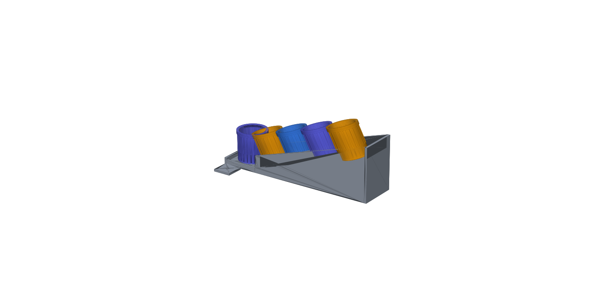

# Esperanza

**Un cargador de tomas y dos movimientos aprendidos.** Equipo **PTI** · Physical AI Hackathon Bilbao 2026 · SO-101 + LeRobot 0.7.0.

La familia carga la semana en vasitos ya rellenados, en orden, en una rampa impresa en 3D. A la hora
de cada toma, el brazo **entrega** el primer vasito en una marca verde. La cámara comprueba que es la
toma que toca, Esperanza se la toma y la cámara comprueba que vuelve vacío. El brazo lo **recoge** a
una caja y la familia recibe un mensaje. Sin electrónica añadida: la rampa es una pieza de plástico.

> Concepto de demostración. **No es un dispositivo médico.**



## Por dónde empezar

| Si eres... | Lee esto |
| --- | --- |
| Cualquiera del equipo | [docs/HACKATON.md](docs/HACKATON.md): el plan del fin de semana, paso a paso, con todos los comandos |
| Quien imprime | [`piezas/stl/`](piezas/stl): rampa, vasito y probeta. Primero la probeta |
| Quien integra (voz, cámara, Telegram) | [`orquestador/esperanza_real.py`](orquestador/esperanza_real.py) |
| Curioso | [docs/SIMULADOR.md](docs/SIMULADOR.md): el ensayo en simulación y qué cambió en la rampa |

Vídeos: [concepto](docs/videos/esperanza_concepto.mp4) · [simulación](docs/videos/esperanza_simulacion.mp4)

## Las dos habilidades (políticas ACT)

| Habilidad | Texto exacto de la tarea (igual al grabar y al desplegar) |
| --- | --- |
| entregar | `take the first cup from the loader and place it on the green mark` |
| recoger | `pick up the empty cup from the green mark and drop it into the used box` |

Datasets y modelos en Hugging Face: `Josebarv01/esperanza_entregar`, `Josebarv01/esperanza_recoger`,
`Josebarv01/act_esperanza_entregar` y `Josebarv01/act_esperanza_recoger` (se crean durante el evento).

## Qué hay en el repositorio

```
docs/            plan del hackathon, simulador, imágenes y vídeos
piezas/          make_stl.py (paramétrico) y las STL para imprimir
orquestador/     la toma completa con el robot real
herramientas/    comprobar el portátil y entrenar en Windows
simulador/       el ensayo en MuJoCo (opcional)
```

## Instalación (Windows 11 nativo, sin WSL; probada el 19-nov-2026)

En WSL las cámaras USB no funcionan, por eso usamos Windows directamente. En Ubuntu o macOS basta la
instalación de la guía oficial (https://hackathonbilbao.eus/guia-so-101).

1. Instalar Miniforge (https://github.com/conda-forge/miniforge) y, en PowerShell:

```
conda init powershell
```

2. Cerrar y abrir PowerShell:

```
conda create -y -n lerobot python=3.12 ffmpeg -c conda-forge
```

```
conda activate lerobot
```

3. PyTorch con CUDA **antes** que LeRobot (si no, pip instala torch sin GPU). Torch 2.15 no está
publicado con CUDA para Windows; 2.14.1 con CUDA 12.6 funciona:

```
pip install torch==2.14.1 torchvision --index-url https://download.pytorch.org/whl/cu126
```

```
pip install "lerobot[core_scripts,training,feetech]==0.7.0" "torch==2.14.1+cu126" "torchvision==0.29.1+cu126" matplotlib pyttsx3 --extra-index-url https://download.pytorch.org/whl/cu126
```

4. Si C: va justo de espacio, mandar los datos a otro disco (y abrir una PowerShell nueva):

```
[Environment]::SetEnvironmentVariable("HF_HOME", "E:\HACKATONLeRobot\hf_cache", "User")
```

5. Iniciar sesión en Hugging Face (token de **escritura**; pegarlo solo en la terminal) y comprobar:

```
hf auth login
```

```
powershell -ExecutionPolicy Bypass -File herramientas\comprobar.ps1
```

**En Windows, para entrenar** se usa `python herramientas\lerobot_train_windows.py` con los mismos
argumentos que `lerobot-train`. El normal se cae al guardar el primer checkpoint, porque Windows no
deja crear el enlace `checkpoints/last` sin el Modo de desarrollador.
