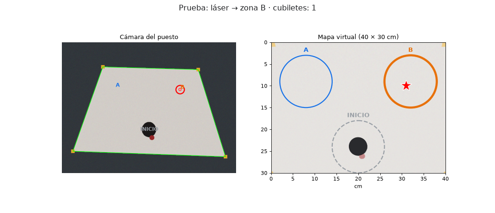

# Apunta y el robot lo lleva

**Equipo PTI** · Physical AI Hackathon Bilbao 2026 · SO-101 + LeRobot 0.7.0

Apuntas con un láser a un sitio de la mesa y el brazo SO-101 lleva allí el cubilete.
La cámara del puesto convierte la mesa en un **mapa virtual** en centímetros: ve los cubiletes,
el punto del láser y las zonas. El movimiento lo hacen **políticas ACT entrenadas con
demostraciones** teleoperadas.



## Por dónde empezar

**[docs/INSTALAR.md](docs/INSTALAR.md)**: instalar y lanzar la demo en otro portátil (estado final, 22-nov-2026).

**[docs/PLAN.md](docs/PLAN.md)**: el plan paso a paso, con todos los comandos (montar la mesa,
calibrar, grabar, entrenar, probar y la demo).

## Qué hay en el repositorio

| Carpeta | Qué es |
| --- | --- |
| `app/config.json` | Lo único que hay que editar en el puesto: cámara, medidas de la mesa, puerto del robot y políticas |
| `app/calibrar.py` | Calibración de la mesa: clic en 4 esquinas, INICIO y las zonas |
| `app/mapa.py` | El mapa virtual en vivo (cámara + mesa vista desde arriba, láser y cubiletes) |
| `app/orquestador.py` | Láser → zona → `lerobot-rollout` de la política de esa zona → comprueba si llegó |
| `app/vision.py` | La visión (OpenCV): mesa en centímetros, láser, cubiletes |
| `tests/test_vision.py` | Prueba sin cámara ni robot: `python tests/test_vision.py` |
| `herramientas/` | Comprobar el portátil y entrenar en Windows |
| `piezas/cubilete.stl` | El cubilete impreso (41 mm de diámetro, nervios para la pinza) |

## Instalación

**Mac o Ubuntu (el portátil del robot):** la de la guía oficial (https://hackathonbilbao.eus/guia-so-101)
y además `pip install matplotlib`.

**Windows (el portátil que entrena; sin WSL, porque en WSL las cámaras no funcionan):**

```
conda create -y -n lerobot python=3.12 ffmpeg -c conda-forge
```

```
conda activate lerobot
```

```
pip install torch==2.14.1 torchvision --index-url https://download.pytorch.org/whl/cu126
```

```
pip install "lerobot[core_scripts,training,feetech]==0.7.0" "torch==2.14.1+cu126" "torchvision==0.29.1+cu126" matplotlib --extra-index-url https://download.pytorch.org/whl/cu126
```

En Windows, para entrenar, `python herramientas\lerobot_train_windows.py` con los mismos argumentos
que `lerobot-train`. El normal se cae al guardar el primer checkpoint.
