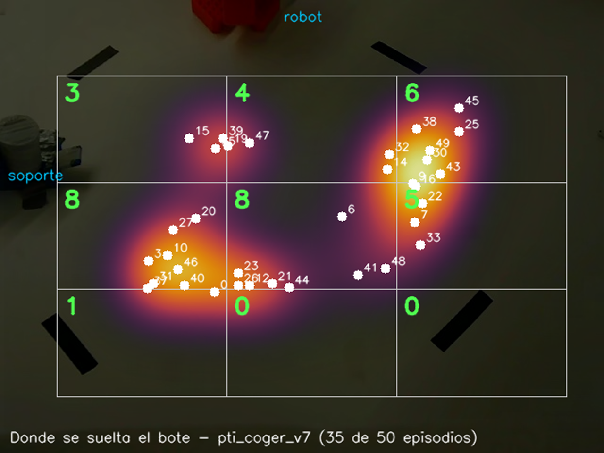

# Diario del equipo PTI (Physical AI Hackathon Bilbao, 20-22 nov 2026)

Todo lo que hacemos, en orden. Sirve para no repetir errores y para el pitch
("qué falló y cómo lo diagnosticamos").

## Viernes 20

### Puesto
- SO-101 conectados al portátil de Joseba (Windows 11, RTX 2060 6 GB). LeRobot 0.6.2 en `lerobot\.venv`.
- Leader COM7 (5,5 V), follower COM8 (12,5 V). ids `leader_puesto` / `follower_puesto`. Calibrados.
- Cámara cenital: índice 2, 640x480.

### Problema: `lerobot-info` fallaba (torchcodec)
- Causa: FFmpeg del sistema es el 9; torchcodec 0.11 solo admite 4–8.
- Solución: FFmpeg 8 compartido en `E:\miniforge3\envs\ffmpeg8` y delante en el PATH.

### Filtro de cámara para el láser
- El punto del láser ocupaba 2–3 píxeles: ACT casi no lo vería.
- Exposición fija -6 y saturación 80 (`herramientas\camara_laser.py`): la escena se oscurece
  y el láser destaca (rojo 128 frente a < 100 del resto).
- `herramientas\lerobot_laser.py` dibuja un círculo rojo de 12 px donde está el láser en cada
  fotograma, igual al grabar y al desplegar.

### Idea final
- Modelo 1 "coger": el bote siempre en el mismo sitio (soporte); el brazo lo coge y lo levanta
  a una postura fija de "llevando".
- Modelo 2 "llevar": desde esa postura, lleva el bote a donde apunta el láser y lo deja.

### Modelo 1, primera prueba (`coger_v2`)
- Dataset `Josebarv01/pti_coger_v2`: 15 episodios, 10 628 fotogramas (episodios de 19 a 32 s, largos).
- Problemas al grabar: el episodio se cortaba solo a los 15 s → `episode_time_s=60`,
  `reset_time_s=300` y se controla con las flechas. Relanzar con el mismo nombre falla
  (la carpeta ya existe) → cambiar de nombre (`v2`, `v3`...) o `--resume=true`.
- Entrenamiento: ACT, 5000 pasos, batch 8, 26 min 42 s en la RTX 2060 (3,1 pasos/s).
- Resultado en el robot: **1 de 5** cogidas bien. "Pilla la idea" pero **tiembla mucho**.
- Siguiente: probar con temporal ensembling (`--policy.n_action_steps=1
  --policy.temporal_ensemble_coeff=0.01`), más episodios y más pasos.

### Modelo 1: más datos antes de reentrenar
- Se lanzó `coger_v3` (20 000 pasos con los mismos 15 episodios) y se **canceló a los pocos
  minutos**: primero más grabaciones (regla: antes de tocar entrenamiento, añadir datos).
  La carpeta `outputs/train/coger_v3` queda a medias: el siguiente entrenamiento usa `coger_v4`.
- Plan: 35 episodios más en `pti_coger_v2` (`--resume=true`) hasta 50, cortos (~10 s) y decididos.
- Probar modelos viendo la cámara en directo: `herramientas\probar.ps1` (Rerun, `--display_data=true`).

### Cámara de muñeca, falsos láser y mesa sin cartulina (~22:00)
- Cámaras: 0 = webcam del portátil, **1 = muñeca**, 2 = cenital. Se graba con top (2) + wrist (1).
  Con otra cámara el dataset cambia: no se puede añadir a `pti_coger_v2`.
- `--display_data=true`: Rerun con las dos cámaras, articulaciones y un **mapa** de la mesa
  (si existe `app/calibracion.json`; el mapa no se graba).
- `pti_coger_v3` (4 episodios) descartado: el filtro ponía un círculo falso sobre la **base
  naranja** del robot en la mitad de los fotogramas. Arreglo: detectar solo picos pequeños
  (top-hat) con rojo > 190. `pti_coger_v4` quedó vacío.
- Error al grabar: "Input voltage error" en el servo 6 del **leader** → revisar su fuente de 5 V.
- Se quita la cartulina: fondo = mesa blanca. `pti_coger_v5` descartado: círculos falsos sobre
  el propio brazo (naranja) en 158 de 935 fotogramas. Arreglo: si el punto rojo está pegado a una
  mancha rojiza grande (> 250 px, el brazo), se descarta. Probado: 0 falsos en esos 935 fotogramas
  y un láser pegado en la mesa se detecta 19 de 19. Se graba en `pti_coger_v6`.

### Dataset bueno del modelo 1: `pti_coger_v7` (~23:15)
- `pti_coger_v6` quedó vacío; se grabó en **`Josebarv01/pti_coger_v7`**: **50 episodios**,
  43 886 fotogramas (19–36 s por episodio), cámaras top (2) + wrist (1), mesa blanca, 446 MB.
- Copias (los vídeos pesan > 100 MB, no caben en GitHub):
  - Hugging Face Hub: https://huggingface.co/datasets/Josebarv01/pti_coger_v7 (público, tamaños verificados).
  - Local: `E:\HACKATONLeRobot\_copias\pti_coger_v7_50ep`.

### Entrenamiento `coger_v7` (noche, 00:14 → 03:27)
- ACT, 20 000 pasos, batch 8, checkpoints cada 2 500. 3 h 12 min (1,74 pasos/s con dos cámaras).
- Loss: 7,14 (paso 200) → 0,155 (paso 20 000). 3,65 épocas.
- Modelo: `lerobot\outputs\train\coger_v7\checkpoints\{002500 ... 020000, last}` y en el Hub
  https://huggingface.co/Josebarv01/act_pti_coger_v7.
- Portátil: suspensión/hibernación "nunca" y cerrar tapa "no hacer nada" para entrenar de noche.
- Siguiente: probar 020000 con `herramientas\probar.ps1` (ya con top + wrist); si falla, 015000 y 010000.

### Prueba de `coger_v7` en el robot (sábado por la mañana)
- 10 intentos con el checkpoint 020000, suavizado y `max_relative_target=10`.
- **Coger: muy bien.** Coge el bote del soporte prácticamente siempre y sabe que está siempre en el mismo sitio.
- **Dejar: siempre en el mismo sitio, haga lo que haga el láser.** Es lo esperado: en las 50 demostraciones el
  láser estaba apagado y se dejaba en un sitio fijo, así que el modelo no ha aprendido a mirar el láser.
- Fallos: en la 5 lanza el bote hacia arriba al soltar. En la 9 tarda hasta el final del tiempo en coger.
  En la 7 se cambió el fondo (no tocarlo: el modelo se entrenó con la mesa blanca).
- No tiembla como `coger_v2`: más datos (15 → 50 episodios), dos cámaras y el suavizado.
- Conclusión: el **modelo 1 funciona**. Ir al láser es trabajo del **modelo 2**, que necesita demostraciones
  con el láser encendido y destinos distintos.

## Tabla de resultados

| Modelo | Checkpoint | Suavizado | Aciertos | Notas |
| --- | --- | --- | --- | --- |
| coger_v2 | 5000 | no | 1/5 | tiembla mucho |
| coger_v7 | 20000 | sí | coger ~9/10 | deja siempre en el mismo sitio (no mira el láser); 1 lanzamiento |

### Mapa de calor: dónde se soltó el bote en `pti_coger_v7`
- 
- Método: final del tramo «pinza ≈ 20» (bote sujeto) + punta del brazo naranja en la cámara cenital. 35 de 50 episodios fiables.
- Resultado: **3 grupos** (derecha, cerca del robot: ~13; abajo-izquierda: ~13; arriba-centro: ~6). Fila lejana casi vacía (1) y centro vacío.
- Para el modelo 2: repartir los destinos por toda la mesa, sobre todo la fila lejana y el centro.

### Entrenamientos en la nube (HF Jobs, $20 de créditos) — sábado 13:50
- Grabado con **fondo negro** por tipos de movimiento (`docs/PLAN_LASER.md`): 45 episodios buenos en `pti_laser_todo`.
- Lanzados en paralelo en `a10g-large` ($1,50/h), los dos afinando desde `coger_v7`:
  - `laser_v1`: solo `pti_laser_todo` (45 ep., negro), 10 000 pasos. Job `6b01935f4fdc5ab3c55d2919`, modelo `Josebarv01/laser_v1_2026-11-21_12-49-24`.
  - `todo_v1`: `pti_todo_v7_laser` = `coger_v7` + láser (95 ep., blanco + negro), 15 000 pasos. Job `6b0193874fdc5ab3c55d2942`, modelo `Josebarv01/todo_v1_2026-11-21_12-50-08`.
- Comando: `lerobot-train --job.target=a10g-large --job.timeout=3h --job.detach=true ...` (sube el dataset al Hub como privado).

- Tras 3 fallos de arranque (versión de LeRobot de la imagen, sin `pip`, comillas) se usa `herramientas\entrenar_nube.ps1`, que instala nuestro commit (0.6.2) en la máquina. A10G: **6,25 pasos/s** (3,5× el portátil).
- **`laser_v1` terminado** (13:23): 10 000 pasos, loss 0,344 → ~0,16. `Josebarv01/act_pti_laser_v1`, descargado en `lerobot\outputs\nube\laser_v1` y comprobado que carga en el portátil.

- Prueba de `laser_v1` (fondo negro, `-Bloque 10`): **coge y sigue el láser muy bien**, pero **no suelta al apagar el láser**.
  Hipótesis: en las grabaciones el círculo se corta 0,5–2 s mientras se sigue (el bote/brazo tapa el punto), así que «sin láser» no significa siempre «soltar».
- **`todo_v1` terminado** (13:40): 15 000 pasos, 95 episodios. `Josebarv01/act_pti_todo_v1`, en `lerobot\outputs\nube\todo_v1`; carga en el portátil.

- **`todo_v1` SÍ suelta al apagar el láser** y funciona mucho mejor que `laser_v1`, pero con `-Bloque 10` va a trompicones. Se prueba suavizado (`-Coef 0.01` y `-Coef -0.05`).

### Mapa de calor completo (95 episodios) — `docs/img/mapa_calor_completo.png`
- Hoy (negro) se suelta donde se apaga el láser: columnas izquierda (≈19) y derecha (≈12) y centro (≈14); la fila lejana casi vacía (4 de 45).
- El recorrido del láser cubre bien la cartulina, pero hay un **punto caliente falso en el soporte** (borde izquierdo): el filtro marca algo rojo del bote/soporte como láser en muchos fotogramas.

### Refuerzo del centro y `todo_v2` (sábado ~16:10)
- `pti_laser_H_centro`: 28 episodios buenos según `docs/ESCALETA_CENTRO.md`; sueltas donde tocaba (centro 10, casilla 6: 6, fila lejana 9).
- Mapa de calor con la rejilla ajustada a la cartulina: `docs/img/mapa_calor_v2.png` (la rejilla de los mapas anteriores cubría toda la imagen, no la cartulina).
- `pti_todo_v2` = `pti_todo_v7_laser` + H = 123 episodios. Subido al Hub (privado; hizo falta crear la etiqueta `v3.0`).
- `todo_v2` entrenando en la nube **desde `todo_v1`**, 10 000 pasos. `todo_v1` no se toca: solo se cambia si `todo_v2` gana en 10 intentos con los mismos puntos.

- **`todo_v2` terminado** (~16:42): 10 000 pasos desde `todo_v1` con 123 episodios, loss ~0,16. `Josebarv01/act_pti_todo_v2` → `lerobot\outputs\nube\todo_v2`; carga en el portátil.

- Prueba `todo_v2` (manual, `-Coef -0.05` / `0` / `0.01`): funciona pero **tiembla y va más lento que `todo_v1`**. Descartado: demos más lentas (H 107 °/s ≈ láser 105 °/s) y cambio de normalización (< 3 %). Hipótesis: poco entrenamiento (10k pasos < 1 época) y pausas aprendidas del H.
- Fallos `There is no status packet` al conectar (servos 6 y 4): servos sanos (0/600 fallos leyendo). `lerobot_laser.py` reintenta 3 veces las escrituras de configuración.
- **`todo_v3`** en la nube: desde `todo_v1`, `pti_todo_v2` (123 ep.), **25 000 pasos** (~2 épocas). Job `6b01c756efaf5e14f4b5b759`. `todo_v1` sigue siendo el de la demo hasta que v3 gane.

- **`todo_v3` terminado** (~18:40): `Josebarv01/act_pti_todo_v3` → `lerobot\outputs\nube\todo_v3`; carga en el portátil. Pendiente: 10 intentos v1 vs v3 en los mismos puntos.

### Análisis de por qué v2/v3 no sueltan donde toca (~20:00)
- Descartado (comprobado sin mover el brazo): Hz (grabado a 30, rollout a 29,6–29,7), calibración (sin cambios desde el 20-nov 19:55), escena (cartulina ±2 px, mismo brillo), filtro del láser (sin cambios), arquitectura (igual en v1/v2/v3).
- Grabaciones: tras desaparecer el círculo, el operador tarda **~3 s** en soltar y el brazo se mueve a ciegas (~60° de `shoulder_lift`). Igual en los episodios L y H.
- Evaluación sin robot sobre 16 episodios grabados: **v3 es el que mejor imita** (error 2,6° frente a 3,6° de v1 en episodios que vieron todos; mejor sitio y momento de soltar).
- v1 sobre los episodios H (que no vio) falla mucho (error medio del bloque 14° frente a 4,6°): **los modelos no generalizan bien a recorridos nuevos del láser**.
- Modo 30 Hz en paralelo simulado sobre grabaciones: suelta ~2 fotogramas (0,06 s) más tarde que el modo síncrono. No es la causa.
- Siguiente: 5 intentos v1 y 5 v3 con el mismo protocolo que en las grabaciones (láser quieto hasta que el cubilete esté encima, apagar y esperar 4 s).

### `v4_all_data` y `v4_saturday_data` (lanzados ~20:34)
- Los dos **desde cero** (ACT, ResNet-18 de ImageNet), `pti_todo_v2`, 5 vueltas, batch 8, lr 1e-5, chunk 100, sin aumento de imagen, semilla 1000.
- Reservados para evaluar sin robot (no se entrenan en ninguno): episodios 58, 70, 84 (L) y 99, 106, 117 (H).
- `v4_all_data`: 117 ep., 91 077 fotogramas, 57 000 pasos, checkpoint cada 11 400. Job `6b01f21e4fdc5ab3c55e2332` → `Josebarv01/act_pti_v4_all_data`.
- `v4_saturday_data`: sin los 50 de `coger_v7` → 67 ep., 47 191 fotogramas, 29 500 pasos, checkpoint cada 5 900. Job `6b01f2204fdc5ab3c55e2335` → `Josebarv01/act_pti_v4_saturday_data`.
- Checkpoints subidos al Hub según se guardan (`--save_checkpoint_to_hub=true`). Los dos a ~6,2 pasos/s.

### Modelos uniformes (~22:30)
- Sueltas por casilla (3×3 sobre la cartulina) medidas con la punta de la pinza al abrir. Mapas en `docs/img/mapa_calor_*.png`.
- Episodios malos detectados: 91 y 111 (la pinza se cierra sin el bote), 78 (no suelta antes del final). También estaban en v2/v3/v4.
- `v4_uniforme_36`: 4 por casilla en las 9 casillas, 36 ep., 25 103 fotogramas, 5 vueltas (15 700 pasos). Job `6b020b07efaf5e14f4b66f83`.
- `v4_uniforme_sin_fila_robot`: sin la fila junto a la base del robot, máx. 6 por casilla (6/6/6 y 6/5/6), 35 ep., 24 628 fotogramas, **8 vueltas** (24 600 pasos), checkpoint cada 2 vueltas. Job `6b020e254fdc5ab3c55e51c9`.
- Los dos desde cero, sin `coger_v7` (mesa blanca) y sin los 6 reservados.
- **Corrección:** 91 y 111 NO son malos (el follower sujeta el bote a ~19,5; el operador apretó el leader hasta el fondo). El único descartado es el 78.
- Grabados 14 episodios de relleno en `pti_laser_I_uniforme` (tipo I de `grabar_laser.ps1`); 3 cayeron en la fila del robot.
- `v4_uniforme_sin_fila_robot` **cancelado** (~23:00) para dejar solo el de 53.
- **`v4_uniforme_53`**: `pti_todo_v3_uniforme` (= `pti_todo_v2` + los 14 nuevos, 137 ep.), sin la fila junto al robot, 8–9 por casilla (8/9/9 y 9/9/9), 53 ep., 37 639 fotogramas, desde cero, 6 vueltas (28 200 pasos), checkpoint cada 2 vueltas. Job `6b0215674fdc5ab3c55e5c27`. Mapa: `docs/img/mapa_calor_uniforme_final.png`.
- `v4_uniforme_36` **descartado** (en el robot se va a un lado; sin robot: encoge los giros, error 11,3° en los reservados). Copia local borrada; sigue en el Hub.
- **`v4_all_data` funciona muy bien en el robot** (~23:20). Sin robot: correlación 0,98 en los reservados, pero se queda corto hacia el lado del soporte.
- **`v4_all_data_plus`**: afinado **desde `v4_all_data`** con `pti_todo_v3_uniforme` (todo lo de all_data + los 14 nuevos), sin los 6 reservados, 18 900 pasos (~1,5 vueltas), checkpoint cada 6 300. Job `6b021916efaf5e14f4b68f1c`.

### Domingo de madrugada: follower nuevo (~00:45–02:00)
- Se rompió el servo de la pinza del follower probando `v4_all_data`. Nos dieron otro brazo (sale en COM9). Calibración vieja guardada en `herramientas/calibracion_puesto/follower_puesto_brazo_roto_viernes_sabado.json`.
- Calibrado con `calibrar.ps1 follower`. Comparado con el viejo: la cámara de muñeca, recolocada, coincide (pinza a 5 px, 0,1°). La imagen no es el problema.
- Ajuste fino sin recalibrar (`herramientas/ajustar_calibracion.py`), comprobando con replay del episodio 97 de `pti_todo_v2` y la cámara cenital: `wrist_flex` −3,6° (medido en el tope de reposo), `wrist_roll` −6° (medido por el giro de la imagen de muñeca frente a 60 grabaciones), `shoulder_pan` +1,7° neto (a ojo, tras varios replays). Con eso el replay suelta el cubilete donde el original.
- Web: cámaras cenital + muñeca arriba a la izquierda (el panel de Control ya no las tapa), tarjeta de ejecución abajo a la derecha. La imagen de muñeca va por UDP 5057 (`lerobot_laser.py` → `gemelo.py`), solo para mostrar.
- Instalación en otro portátil: `docs/INSTALAR.md`.
