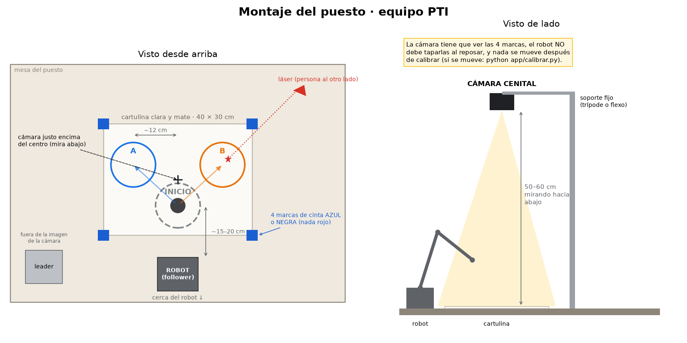

# Plan paso a paso: el robot lleva el cubilete a donde apunta el láser

**Prueba fácil (fase 1):** el cubilete empieza siempre en **INICIO**. Hay **2 zonas de destino, A y B**.
Apuntáis con el láser a una zona, el programa la reconoce en el mapa virtual y el robot ejecuta la
habilidad entrenada para esa zona: **«llevar a A»** o **«llevar a B»** (dos políticas ACT).

Reparto: el **Mac de Aitor** va al robot (calibrar, grabar, ejecutar). El **Windows de Joseba** entrena.
Se pasan datos y modelos por Hugging Face.

---

## 1. Montar la mesa (15 min)



1. Una zona **clara y mate** de unos 40 × 30 cm delante del robot: la propia mesa si es blanca,
   o una cartulina. Los cubiletes son negros: sobre fondo claro la cámara los ve bien.
   Quitar de la vista de la cámara todo lo demás (la rampa, cajas, herramientas).
2. **4 marcas en las esquinas** (rotulador o cinta, **azul o negra**). Nada rojo ni naranja dentro de
   ese rectángulo: se confunde con el láser (fuera de él da igual, el programa solo busca dentro).
3. Dibujar 3 círculos de unos 12 cm de diámetro:
   - **INICIO**, unos 20 cm delante del robot;
   - **A** a un lado y **B** al otro, a unos 15 cm de INICIO.
   Comprobar teleoperando que el robot llega cómodo a los tres.
4. Medir el rectángulo de las 4 marcas con la regla y escribirlo en `app/config.json` → `mesa_cm`.
5. La **cámara cenital**, fija y viendo toda la cartulina. Luz siempre igual y nadie en la imagen.

**Láser:** puntero de clase 2 (los normales, menos de 1 mW). **Nunca a los ojos ni a la cámara de frente.**

## 2. Preparar el Mac (Aitor)

Con LeRobot 0.7.0 ya instalado según la guía oficial:

```
conda activate lerobot
```

```
pip install matplotlib
```

```
git clone https://github.com/Joseba-Rodriguez/pti-hackathon-bilbao-2026.git
```

```
cd pti-hackathon-bilbao-2026
```

```
lerobot-find-port
```

```
lerobot-find-cameras opencv
```

Con lo que salga, editar `app/config.json`:
- `camara.indice`: el índice de la cámara cenital.
- `robot.puerto`: el del follower (en Mac, `/dev/tty.usbmodem…`).
- `robot.camaras`: los índices de las cámaras `top` (la cenital) y `wrist` (la de la muñeca).

## 3. Calibrar la mesa y probar el láser (sin robot)

```
python app/calibrar.py
```

Clic en las 4 esquinas (superior izquierda, superior derecha, inferior derecha, inferior izquierda),
luego en el centro de INICIO, A y B.

```
python app/mapa.py
```

Mover el láser por la mesa: en el mapa virtual tiene que aparecer la ★ y decir «zona A» o «zona B».
Poner el cubilete en INICIO: tiene que salir «cubiletes: 1».
- Si **no ve el láser**: bajar `laser.umbral` en `config.json` (por ejemplo, a 60).
- Si **ve láser donde no lo hay**: `python app/mapa.py --ajustar` muestra qué cree que es láser; subir el umbral.
- Si **no ve el cubilete**: subir `cubilete.umbral_gris` (por ejemplo, a 90).

## 4. Calibrar el robot (una sola vez)

```
lerobot-calibrate --robot.type=so101_follower --robot.port=PUERTO_FOLLOWER --robot.id=pti_follower
```

```
lerobot-calibrate --teleop.type=so101_leader --teleop.port=PUERTO_LEADER --teleop.id=pti_leader
```

Teleoperar para probar (**una persona mirando, con la mano en la alimentación**):

```
lerobot-teleoperate --robot.type=so101_follower --robot.port=PUERTO_FOLLOWER --robot.id=pti_follower --robot.cameras="{ top: {type: opencv, index_or_path: 1, width: 640, height: 480, fps: 30}, wrist: {type: opencv, index_or_path: 0, width: 640, height: 480, fps: 30} }" --teleop.type=so101_leader --teleop.port=PUERTO_LEADER --teleop.id=pti_leader --display_data=true
```

## 5. Grabar las demostraciones (30 por zona)

Reglas (lo que más influye en el resultado):
- **Láser apagado** al grabar. El robot no lo necesita: la zona la elige el programa.
- Siempre **la misma persona** en el leader, cogiendo el cubilete **del mismo modo**.
- Empezar y acabar siempre en la **misma postura de reposo**.
- Soltar el cubilete **casi tocando la mesa**, sin dejarlo caer.
- En la pausa entre episodios, el ayudante vuelve a poner el cubilete en INICIO
  (un poco distinto cada vez, hasta 1 cm, para que el robot aprenda a corregir).

En el Mac, poner antes el usuario de Hugging Face de Aitor:

```
HF_USER=$(NO_COLOR=1 hf auth whoami | awk -F': *' 'NR==1 {print $2}')
```

**Llevar a A:**

```
lerobot-record --robot.type=so101_follower --robot.port=PUERTO_FOLLOWER --robot.id=pti_follower --robot.cameras="{ top: {type: opencv, index_or_path: 1, width: 640, height: 480, fps: 30}, wrist: {type: opencv, index_or_path: 0, width: 640, height: 480, fps: 30} }" --teleop.type=so101_leader --teleop.port=PUERTO_LEADER --teleop.id=pti_leader --dataset.repo_id=${HF_USER}/pti_llevar_A --dataset.num_episodes=30 --dataset.single_task="pick up the cup from the start mark and place it in zone A" --dataset.no_stamp=true
```

**Llevar a B:** el mismo comando cambiando `pti_llevar_A` por `pti_llevar_B` y `zone A` por `zone B`.

Teclas: → o `n` guarda y sigue; ← o `r` repite el episodio; `Esc` o `q` para y sube al Hub.
**Apuntad cuántos episodios se graban y cuántos se repiten** (lo pregunta el jurado).

## 6. Entrenar (Windows de Joseba)

```
conda activate lerobot
```

```
cd E:\HACKATONLeRobot
```

```
python herramientas\lerobot_train_windows.py --dataset.repo_id=USUARIO_HF_DE_AITOR/pti_llevar_A --policy.type=act --output_dir=outputs/train/pti_llevar_A --job_name=pti_llevar_A --policy.device=cuda --steps=15000 --save_freq=5000 --batch_size=8 --policy.repo_id=Josebarv01/act_pti_llevar_A
```

Y lo mismo con `B`. Con posiciones fijas, la guía oficial recomienda 10 000–15 000 pasos.
Mirar `step_s` en los primeros minutos para saber cuánto tardará.

## 7. Probar cada política sola (en el Mac)

**Persona mirando, mano en la alimentación, láser apagado:**

```
lerobot-rollout --strategy.type=base --policy.path=Josebarv01/act_pti_llevar_A --robot.type=so101_follower --robot.port=PUERTO_FOLLOWER --robot.id=pti_follower --robot.cameras="{ top: {type: opencv, index_or_path: 1, width: 640, height: 480, fps: 30}, wrist: {type: opencv, index_or_path: 0, width: 640, height: 480, fps: 30} }" --task="pick up the cup from the start mark and place it in zone A" --duration=20
```

10 intentos por zona, anotando acierto o fallo y **en qué momento falla** (no lo coge, se le cae,
lo deja fuera). Si falla siempre en el mismo sitio: grabar 10 demostraciones más de ese momento
(mismo comando + `--resume=true` + `--dataset.num_episodes=10`) y reentrenar.

## 8. Todo junto: láser → robot

```
python app/orquestador.py --simulacro
```

(No mueve el robot: comprueba que reconoce la zona e imprime el comando.)

```
python app/orquestador.py
```

Apuntar a A o B, mantener el láser quieto 1 segundo, apagarlo y confirmar. Cada intento se
apunta en `resultados/intentos.csv`: es la tabla de aciertos para el jurado.

---

## Fase 2 (solo si la fase 1 va bien)

- **Más zonas**: cada zona nueva es un círculo, una entrada en `config.json` y una política más.
- **Devolver**: una política «de A a INICIO» para que el ciclo se repita solo en la demo.
- **Ir exactamente al punto del láser** (sin zonas): una sola política que vea el punto en la
  cámara, con el láser fijo en un soporte durante la grabación y muchas posiciones distintas
  (100 demostraciones o más). Más espectacular, pero bastante más arriesgado en 48 horas.
